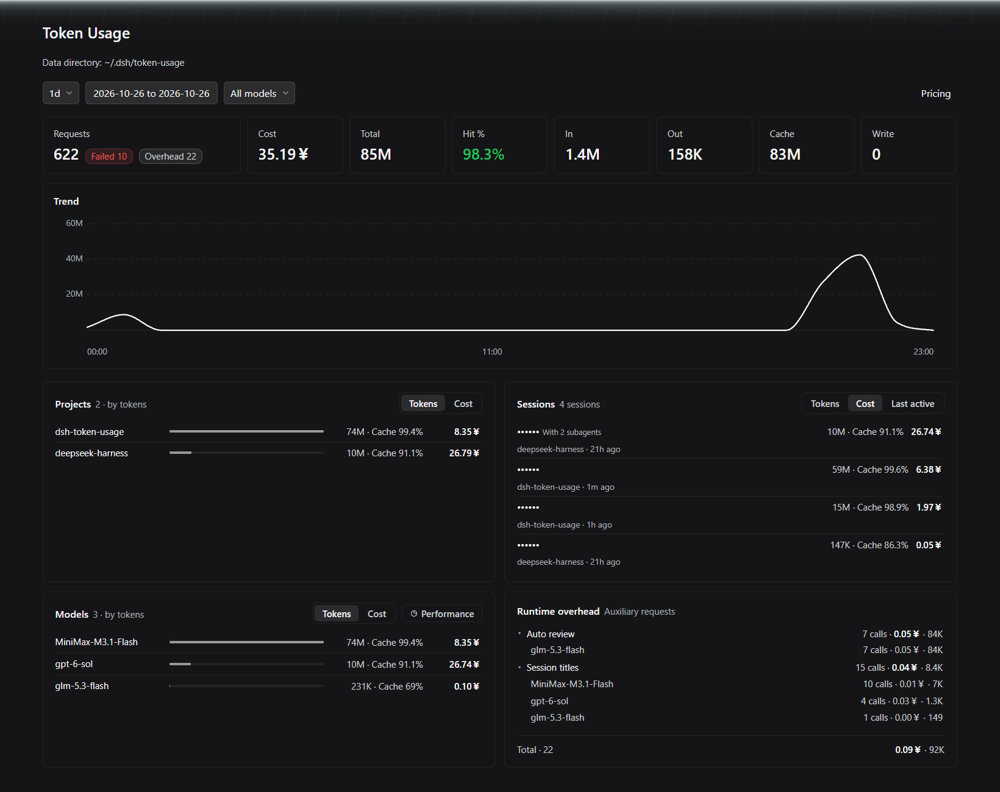
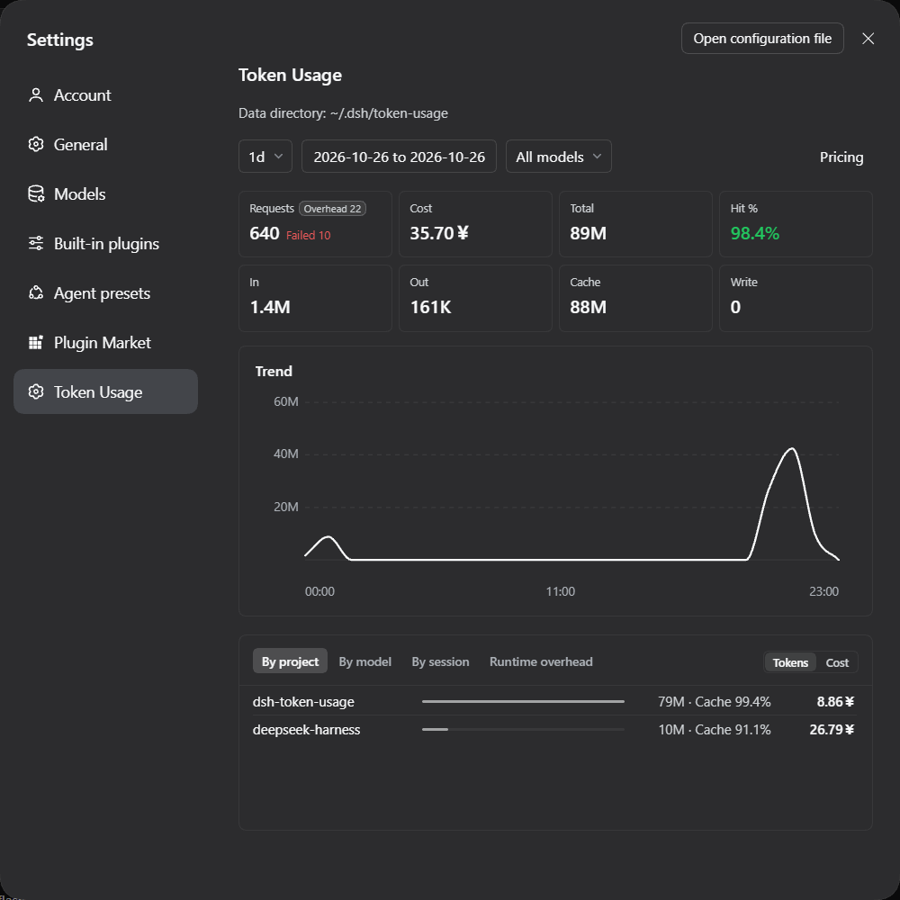
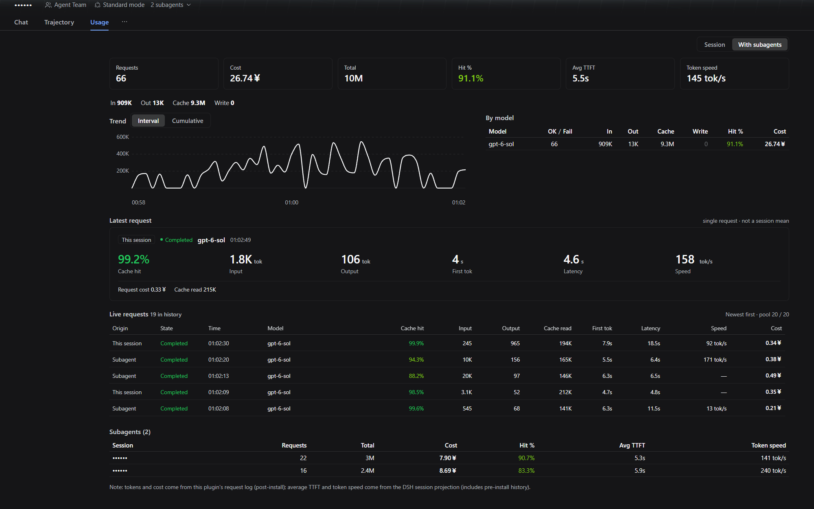
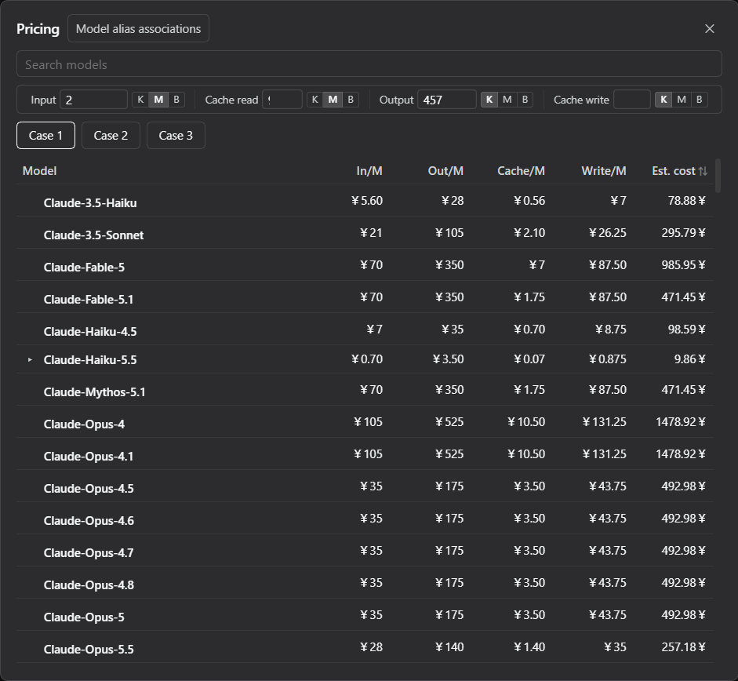
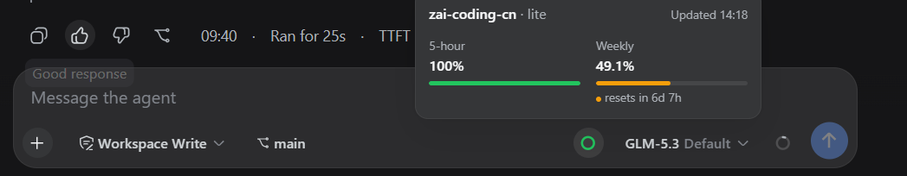
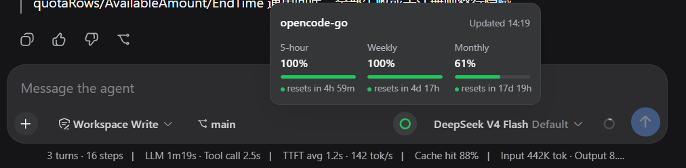

# dsh-token-usage

[](https://awesome-dsh-plugin.com)



[简体中文](./README.zh.md) | English

A dsh usage plugin that displays model token usage right in the Web UI. The sidebar's **Token Usage** entry opens a full-width dashboard — summary cards (with cost), a trend chart, and five detail boards (projects / sessions, models / providers, runtime overhead); the same statistics live in **Settings → Token Usage** behind five detail tabs (by project / by model / by session / by provider / runtime overhead). Both surfaces share date-range and model filters; a single-day range uses an hourly trend and wider ranges use daily points.

[dsh]: https://github.com/cordiverse/dsh

Repo: <https://github.com/LaoYueHanNi/dsh-token-usage>

> [!IMPORTANT]
> **GitHub direct installs have ended** — the repository no longer carries prebuilt output. Install from npm instead:
>
> ```sh
> dsh plugin --profile web add @laoyuehanni/dsh-token-usage
> ```
>
> **Upgrading from a legacy `github:` install (≤ 0.3.7, package name `dsh-token-usage`)?** An in-place `update` fails to load — remove the old name first, then add again. Usage data under `$DSH_HOME/token-usage/` carries over untouched.

## Features

- **Live recording**: every provider-billed model call is recorded as it happens — tokens, cost, model, session — conversation requests, context-compaction calls, and auxiliary system calls included: the Auto review authorization reviewer, session-title generation, and reasoning translation. Auxiliary calls bill into the totals and the model breakdown. The ones the host proves belong to a session (session-title generation) also join that session's totals, trend and request pool, tagged with their kind; the rest stay global and are broken out by kind in the **Runtime overhead** board. That history cannot be backfilled — the host keeps no usage record of those calls, and recording starts with the first request after upgrading.
- **Web stats page**: filters (date range + model + `1d`/`7d`/`30d` shortcuts), eight compact summary cards in two rows, and a trend chart (hourly for one day, daily for wider ranges; hover a point for its total). The request card carries **failed** and **overhead** pills. The detail block is a five-tab switcher — **projects / models / sessions / providers / runtime overhead** — sharing the dashboard's row layout: project rows aggregate every matching root session before the session list is capped; directory-tail grouping intentionally merges folders with the same final segment. Rows sort by total tokens or cost (sessions also by last activity), and **Ctrl+click** on a listed session row opens that conversation (the host restores its last-selected view tab). The runtime-overhead tab breaks auxiliary calls down by kind; the by-provider tab lists each provider's usage by its route key — see the next entry, **Provider usage dimension**.



- **Main-column dashboard**: the sidebar's **Token Usage** entry opens the same metrics as a five-board dashboard (projects / sessions, models / providers, runtime overhead). The boards collapse to one column when the available content width is narrow; **Pin to sidebar** on this plugin's **configuration card** in the host's **Plugins** page moves the entry out of the **More** menu into a resident sidebar row (switch it off to move it back) — the two never coexist.
- **Provider usage dimension**: the settings panel gains a **By provider** tab and the dashboard a **Providers** card, listing each provider route key's usage — display name · relative bar · total tokens · cache hit rate · billed cost (cost comes from the same rates as the by-model view and reprices when the price table updates). The sort switches between total tokens and cost, and each of the two entries remembers its own sort choice (changing it in the settings panel leaves the dashboard untouched). Usage without a route key is never folded into a named provider: it stays a single **Missing provider** remainder row, sorted last and dimmed (a question mark beside the name explains why on hover) — a **known difference**, not lost data: sessions whose logs were deleted, history older than the route-key field, and runtime overhead such as title generation or approval requests naturally carry no route key.
- **Model performance view**: the model list can switch from usage to mean output speed, time to first token, and request latency. Untimed requests do not enter performance evaluation; speed and first-token means use streaming samples, and models with fewer than five streaming samples are marked rather than ranked. Historical timing is backfilled automatically when the rollup format changes.
- **Session usage tab**: the conversation pane gains a **Usage** view tab (beside Chat / Trajectory) with the active session's dashboard — six stat cards (successful requests with a failure pill, cost, cache hit rate, average time-to-first-token, generation throughput, total tokens), a 4-bucket token strip, a trend chart (per-interval or cumulative), and a per-model table. A scope switch toggles **Session / With subagents**, and the subagent table drills into each child and back. Hovering the failure pill breaks failures down per class (rate limited, server error, context exceeded, …).
- **Live request pool**: the same tab adds a **Latest request** panel (cache hit, input, output, first token, latency, speed — cost and cache buckets demoted to the footer) and a **Live requests** table (up to 19 earlier rows; origin, state, time, model, cache hit, input, output, cache read, first token, latency, speed, cost). Waiting, streaming, failed and cancelled requests are visible while they run, every provider attempt is its own row, and a low cache-hit rate is flagged inline with an explanation.



- **Cost figures & model pricing**: per-request cost is computed live from per-model rates (¥ per million tokens); unpriced models warn and count as ¥0. Click a priced model name in the dashboard to open its full price table; holding Ctrl while clicking a priced model filters the view to that model. The filter row carries a **pricing table** entry opening an overview of every model in the cloud feed — searchable, with simulated billing and expandable effective rates; the **Model alias associations** button next to the dialog title opens a separate dialog that manages the local alias→model associations and lets you revoke them. Rates sync from the cloud feed on every startup — see [Model pricing](#model-pricing).



- **Provider quota**: an input-bar button (left of the model chip) shows the selected provider's remaining quota. See [Provider quota](#provider-quota).
- **History backfill**: the first startup syncs requests that happened before installation (idempotent); unreadable session logs are skipped and counted, never fatal to the sync.

## Model pricing

Costs are billed per record at its own timestamp. Identification or pricing-rule changes reselect historical rates from raw records on the next read. Models resolve through full original ID matching, provider-prefix ID matching, then upstream aliasPatterns (deprecated aliases are ignored), all ignoring case while preserving versions and model variants. Unknown or ambiguous names have no inferred price. The single source is a cloud mirror auto-synced on every startup — pricing corrections belong upstream in the [model-price-table](https://github.com/LaoYueHanNi/model-price-table) feed, so every user benefits at once. A hand-edited `pricing.json` is no longer read; if you maintain one it is silently ignored after upgrading (the file is left on disk). Upgrading from 0.4.1 or earlier to 0.4.2 triggers a one-time full rebuild of the usage rollup the first time the stats page is read — the larger the history, the longer it takes; this is expected. An invalid new feed keeps the previous valid mirror. If pricing is unavailable or history cannot be fully repriced, available usage remains visible while unreliable costs are hidden with a reason. Missing entries in a valid feed are warned separately. Unpriced names offer local search, full rule preview and explicit association to an existing cloud model ID. Folded rows retain original sources; Manage model associations also lists inactive or unused choices and supports revocation. Associations preserve upstream billing rules and reprice history. An upstream Issue entry opens a draft for you to complete; it never submits automatically. Default location: `~/.dsh/token-usage/`. Billing rule chain, cloud feed format, and self-hosted mirror URLs: [docs/pricing.md](./docs/pricing.md).

## Configuration

### Data directory

Editable on this plugin's **configuration card** in the host's **Plugins** page: saving an absolute path takes effect immediately — history migrates automatically, no restart, no manual move. Blank keeps the default `~/.dsh/token-usage/`. A save is refused while a conversation is in progress; wait for it to end, then save again. Or set it directly:

```yml
plugins:
  token-usage:
    path: D:/data/token-usage   # default: ~/.dsh/token-usage/
```

### Pricing region

The pricing mirror follows your region: **Gitee** by default (fast inside mainland China) or the **GitHub mirror** of the same table — pick once on the **Pricing region** dropdown of that configuration card in the host's Plugins page, or via config. The pick also drives the display currency (¥ RMB vs $ USD at the table's exchange rate).

```yml
plugins:
  token-usage:
    pricingRegion: overseas   # default: domestic
```

## Provider quota

The input-bar button follows the currently selected provider and opens a panel with remaining quota (API-key providers share the inference key; the DeepSeek account reads the signed-in balance):





| Provider | Shows |
|---|---|
| Zhipu GLM Coding Plan (CN / international) | 5-hour, weekly (some plans also monthly) |
| Kimi For Coding | 5-hour, monthly (legacy responses: weekly) |
| MiniMax Coding Plan (CN / international) | 5-hour, weekly |
| OpenCode Go | 5-hour, weekly, monthly |
| Command Code | 5-hour, weekly, monthly |
| DeepSeek (official API key) | ¥ account balance |
| DeepSeek account | topped-up balance, granted balance |
| OpenRouter | $ remaining credits |
| Magpie gateway | every upstream account's quota cards, scoped to the selected model's provider (routing groups show the whole fleet) |

Unsupported providers hide the button; a failed query can be retried from the panel. On by default; turn it off with `quota.enabled: false`. Not supported yet: Volcengine, ZenMux, Zhipu Team plan, Claude / Codex / Gemini / Grok official subscriptions, GitHub Copilot.

A magpie route needs no setup: declare any OpenAI-compatible provider whose base URL points at the gateway (`http://127.0.0.1:3425/v1` by default) — the plugin probes the gateway's hello and reads its aggregated quota report. The gateway key goes in the provider's API key when the gateway is shared from another machine; a loopback gateway needs none.

Magpie cards follow the selected model immediately, before sending a request. Reads always use `?kept=1`: polling, opening the panel and retrying only read Magpie's own cache, never trigger upstream quota refreshes. Refresh quotas in Magpie when newer readings are needed; an empty cache does not fall back to a live vendor query.

Several keys and accounts of one vendor back each other up inside the gateway: the input-bar ring shows that vendor pool's **mean level** and colors it by the pool's availability (one spent account turns it yellow, only a fully spent pool turns it red), while the panel still lists every account's own share. Routing groups (no determinable request model) keep one level per vendor.

## Install

Requires dsh `0.2.1-rc.3` or newer.

```sh
dsh plugin --profile web add @laoyuehanni/dsh-token-usage
```

> The package declares `dsh.bundle`, so `add` wires the plugin into the profile automatically — installs work out of the box, and the first startup backfills pre-install history.

## Update

```sh
dsh plugin --profile web update @laoyuehanni/dsh-token-usage
```

## Remove

```sh
dsh plugin --profile web remove @laoyuehanni/dsh-token-usage
```

Data files under `$DSH_HOME/token-usage/` are kept — delete them manually if you no longer need them.

## Development

Build once, install a symlink, iterate:

```sh
pnpm install
pnpm build:all
pnpm test                # vitest
dsh plugin --profile web add link:D:/plugins/dsh-token-usage
```

Rebuild and restart `dsh web` to apply changes (`pnpm watch:client` in the plugin directory hot-reloads the client). No `prepare` script by design — `lib/` never enters the repo; `pnpm publish` builds it fresh into the tarball.

Temporary host-only mount (this launch only, no profile changes): copy `cordis.example.yml` to `cordis.yml`, point `name` at the absolute `file://` URL of your `lib/index.js`, then `dsh web --patch <plugin-dir>/cordis.yml`. Data recording works in this mode; for UI work use the `link:` install above.
