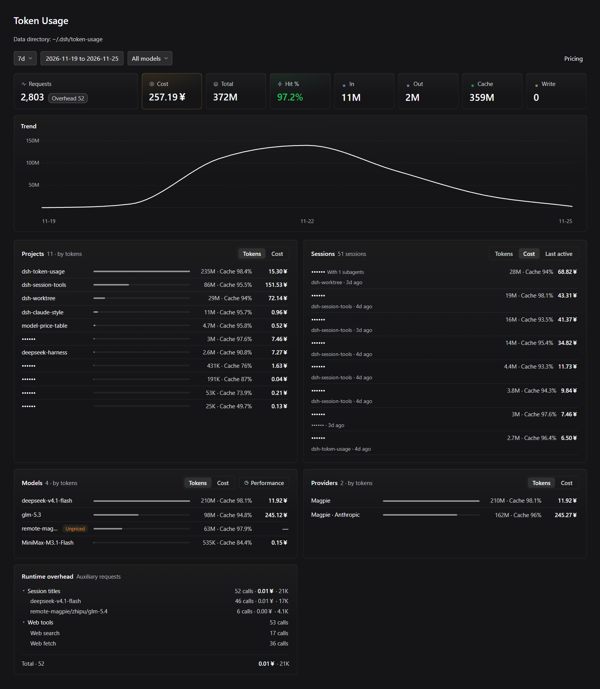
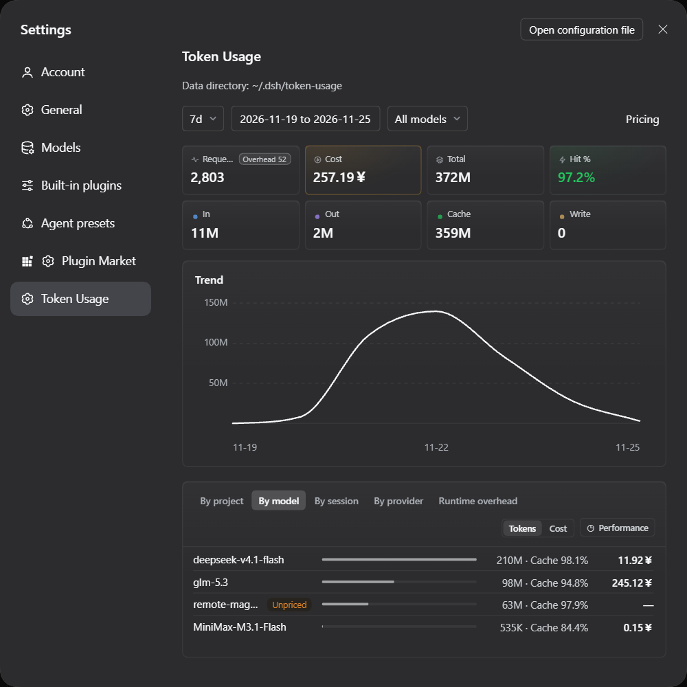
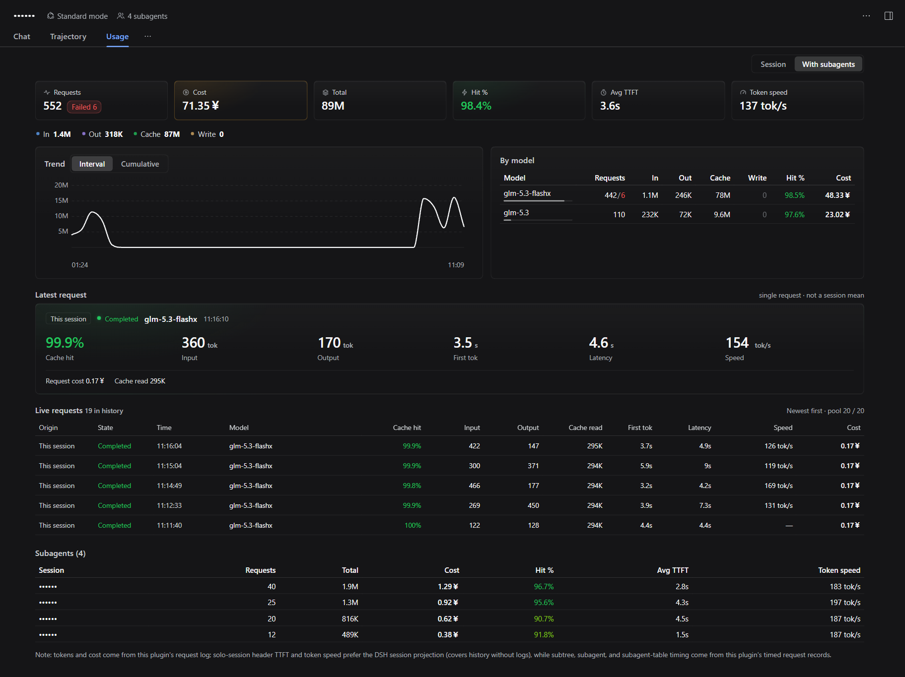
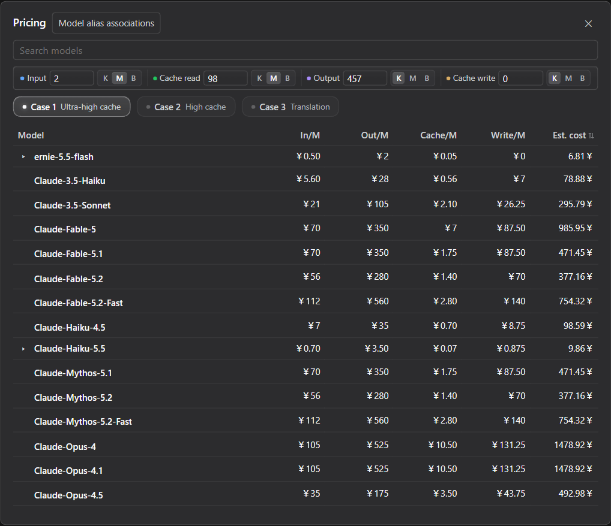
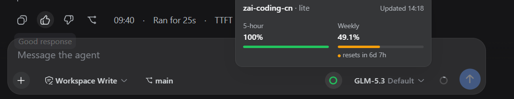
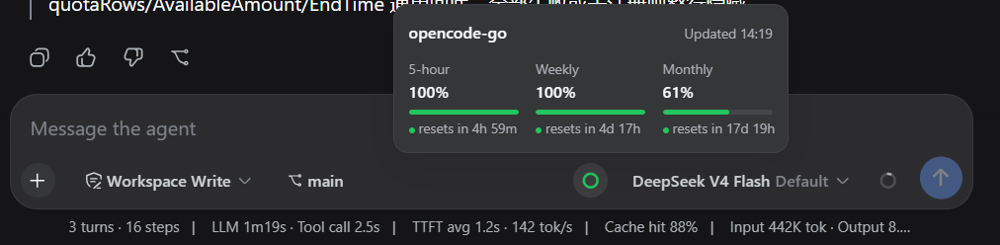

<div align="center">


# dsh-token-usage

**All-in-one token usage, cost accounting, model performance & provider quota plugin for [DeepSeek Harness (dsh)][dsh].**

<p>
  <a href="https://awesome-dsh-plugin.com"></a>
  <a href="https://www.npmjs.com/package/@laoyuehanni/dsh-token-usage"></a>
  <a href="https://www.npmjs.com/package/@laoyuehanni/dsh-token-usage"></a>
  <a href="https://github.com/deepseek-ai/deepseek-harness">= 0.2.1-rc.3" height="20" /></a>
  <a href="./LICENSE"></a>
</p>

[简体中文](./README.zh.md) · **English**

[Install](#install) · [Features](#features) · [Provider Quota](#provider-quota) · [Model Pricing](#4-cost-figures--model-pricing) · [Configuration](#configuration) · [Development](#development)

</div>

<p align="center">
  
</p>

---

## Highlights

| Capability | What you get |
| --- | --- |
| **Usage & Cost Dashboard** | Full-width sidebar dashboard + **Settings → Token Usage** across 5 dimensions: projects, sessions, models, providers, and runtime overhead. |
| **Per-Session & Live Pool** | Dedicated **Usage** tab beside Chat / Trajectory with subagent drill-down, live in-flight request pool, failure breakdown, and low cache-hit alerts. |
| **Model Speed & Latency** | Streaming output speed (tok/s), time-to-first-token (TTFT), and request latency rankings across models. |
| **Cloud Pricing Engine** | Automatic timestamp-accurate cost calculation synced from [model-price-table](https://github.com/LaoYueHanNi/model-price-table) with ¥ / $ support and local alias mapping. |
| **Provider Quota Monitor** | Input-bar quota ring & panel for Zhipu GLM, Kimi, MiniMax, OpenCode Go, Command Code, DeepSeek, OpenRouter, and Magpie gateway. |

---

## Install

Requires **dsh `0.2.1-rc.3`** or newer.

```sh
dsh plugin --profile web add @laoyuehanni/dsh-token-usage
```

> [!TIP]
> The package declares `dsh.bundle`, so `add` wires the plugin into the profile automatically — works out of the box, and the first startup idempotently backfills pre-install history (unreadable session logs are skipped and counted without interrupting sync).

**Update & Remove**

```sh
# Update
dsh plugin --profile web update @laoyuehanni/dsh-token-usage

# Remove (keeps data under $DSH_HOME/token-usage/ — delete manually if no longer needed)
dsh plugin --profile web remove @laoyuehanni/dsh-token-usage
```

<details>
<summary>Upgrading from a legacy <code>github:</code> install (≤ 0.3.7, package name <code>dsh-token-usage</code>)?</summary>

GitHub direct installs have ended — the repository no longer carries prebuilt output. An in-place `update` from `github:` fails to load; remove the old name first, then install from npm:

```sh
dsh plugin --profile web remove dsh-token-usage
dsh plugin --profile web add @laoyuehanni/dsh-token-usage
```

Existing usage data under `$DSH_HOME/token-usage/` carries over untouched.

</details>

---

## Features

### 1. Full-Width Dashboard & Web Settings Page

- **Two synchronized surfaces**: the sidebar **Token Usage** entry opens a five-board full-width dashboard (auto-collapses to one column on narrow viewports); the same statistics live in **Settings → Token Usage** behind five tabs (**Projects / Models / Sessions / Providers / Runtime overhead**).
- **Flexible filtering & navigation**: shared date range + model filter + `1d` / `7d` / `30d` shortcuts, eight compact summary cards (with **failed** and **overhead** pills), and an hourly (single-day) or daily (multi-day) trend chart. Sort rows by tokens, cost, or last activity; **Ctrl+click** a session row to jump directly to that conversation.
- **Sidebar & visibility toggles**: in the host **Plugins** page configuration card, enable **Pin to sidebar** to move the entry out of **More** into a resident sidebar row (mutually exclusive), or toggle **Show Token Usage in Settings** (on by default).

<p align="center">
  
</p>

<details>
<summary>Details: Provider dimension, project grouping & runtime overhead</summary>

- **Provider usage dimension**: lists each provider route key with display name, relative bar, total tokens, cache hit rate, and billed cost. Dashboard and Settings remember their sort order (`tokens` vs `cost`) independently. Usage without a route key (deleted logs, pre-route-key history, or global runtime overhead) stays in a dimmed **Missing provider** remainder row at the bottom with an explanatory tooltip — a known difference, not lost data.
- **Project grouping**: project rows aggregate every matching root session before the session list is capped; directory-tail grouping intentionally merges folders with the same final segment.
- **Live recording & runtime overhead**: records every provider-billed call in real time — main turns, context compaction, and auxiliary calls (Auto review, session-title generation, timeline report synthesis, reasoning translation). **Web tools** (`web_search`, `web_fetch`) record invocation count, query count, duration, and failure state; reported model tokens bill into totals/cost, while untokenized calls appear as counts only in the collapsible web-tools row. Session-attributed auxiliary calls also join that session's totals, trend, and request pool; the rest stay global under **Runtime overhead**. Auxiliary history starts recording after upgrading and cannot be backfilled.

</details>

---

### 2. Session Usage Tab & Live Request Pool

The conversation pane gains a **Usage** view tab beside **Chat** and **Trajectory**:

- **Session dashboard**: six metric cards (successful requests with a hoverable per-class failure pill, cost, cache hit rate, mean TTFT, throughput, total tokens), a 4-bucket token strip, per-interval/cumulative trend chart, and per-model breakdown.
- **Subagent & Team drill-down**: toggle **Session / With subagents** and drill into any child session. Recognizes subagent **semantic names** (DSH 0.2.2+, e.g. `researcher`, `agent-1`), shows a **Team mode** badge when agent-team collaboration is active, and marks remote **external subagents** as dimmed non-local rows.
- **Live request pool**: **Latest request** card plus a **Live requests** table (up to 19 recent attempts) tracking waiting, streaming, failed, and cancelled requests in real time, with inline low cache-hit diagnostics.

<p align="center">
  
</p>

---

### 3. Model Performance View

Switch any model table from usage to **mean output speed**, **time to first token (TTFT)**, and **request latency**:

- Untimed requests are excluded from performance metrics.
- Speed and TTFT means use streaming samples only; models with fewer than 5 streaming samples are flagged rather than ranked.
- Historical timing backfills automatically whenever the rollup format updates.

---

### 4. Cost Figures & Model Pricing

Per-request cost is calculated live at each record's own timestamp (`¥` or `$` per million tokens); unpriced models warn clearly and count as 0.

- Click a priced model name to view its full rate table, or **Ctrl+click** to filter by that model.
- Use the **Pricing table** button in the filter bar to browse/search all cloud models, run simulated billing, and manage local **Model alias associations** (with revocation).

<p align="center">
  
</p>

<details>
<summary>Details: Resolution order, cloud sync & upgrade notes</summary>

- **Resolution order**: full original ID → provider-prefix-stripped ID → upstream `aliasPatterns` (case-insensitive, preserving versions/variants; deprecated `aliases` ignored; unknown or ambiguous names are never guessed).
- **Cloud-first sync**: rates auto-sync on startup from [model-price-table](https://github.com/LaoYueHanNi/model-price-table) — submit pricing PRs upstream so every user benefits. Legacy hand-edited `pricing.json` files are ignored (kept on disk). An invalid feed retains the last valid mirror; when costs cannot be reliably repriced, usage remains visible while unreliable costs are hidden with a reason.
- **Unpriced models**: offer in-place search, full rule preview, explicit local alias association (which reprices history), and a prefilled upstream Issue draft (never auto-submitted).
- **Upgrading from ≤ 0.4.1 to ≥ 0.4.2**: triggers a one-time full rollup rebuild on first read.
- Full billing rule chain, feed format, and self-hosted mirror setup: [docs/pricing.md](./docs/pricing.md).

</details>

---

## Provider Quota

An input-bar button (left of the model chip) follows the currently selected provider and opens a live remaining-quota panel (API-key providers reuse the inference key; DeepSeek account reads the signed-in balance):

<table>
  <tr>
    <td align="center" width="50%">
      
      <br />
      <sub>Zhipu GLM Coding Plan</sub>
    </td>
    <td align="center" width="50%">
      
      <br />
      <sub>OpenCode Go Plan</sub>
    </td>
  </tr>
</table>

| Provider | Quota metrics shown |
| --- | --- |
| **Zhipu GLM Coding Plan** (CN / International) | 5-hour, weekly (some plans also monthly) |
| **Kimi For Coding** | 5-hour, monthly (legacy responses: weekly) |
| **MiniMax Coding Plan** (CN / International) | 5-hour, weekly |
| **OpenCode Go** | 5-hour, weekly, monthly |
| **Command Code** | 5-hour, weekly, monthly |
| **DeepSeek** (official API key) | ¥ account balance |
| **DeepSeek Account** | Topped-up balance, granted balance |
| **OpenRouter** | $ remaining credits |
| **Magpie Gateway** | Aggregated upstream account quota cards scoped to the selected model's provider |

> Unsupported providers hide the button automatically; failed queries can be retried inline. Enabled by default (`quota.enabled: false` to disable). Not supported yet: Volcengine, ZenMux, Zhipu Team plan, Claude / Codex / Gemini / Grok official subscriptions, GitHub Copilot.

<details>
<summary>Magpie Gateway integration details</summary>

- **Zero config**: declare any OpenAI-compatible provider pointing at your Magpie gateway (`http://127.0.0.1:3425/v1` by default) — the plugin probes the gateway's `hello` endpoint automatically. Shared remote gateways read the gateway key from the provider's API key; loopback gateways need none.
- **Cache-only reads (`?kept=1`)**: cards follow model selection immediately before sending a request. Polling, opening the panel, and retrying only read Magpie's cache and never trigger upstream quota refreshes (refresh in Magpie when newer readings are needed).
- **Multi-account pools**: the input-bar ring displays the vendor pool's **mean level** colored by availability (yellow when one account is spent, red only when the entire pool is spent), while the panel lists every account's own share. Routing groups keep one level per vendor.

</details>

---

## Configuration

All options can be edited directly on this plugin's **configuration card** in the host **Plugins** page (changes apply immediately), or configured in `cordis.yml`:

```yml
plugins:
  token-usage:
    path: D:/data/token-usage   # default: ~/.dsh/token-usage/ (migrates history automatically)
    pricingRegion: overseas     # domestic (Gitee, ¥ RMB) | overseas (GitHub mirror, $ USD)
    quota:
      enabled: true             # set false to hide the input-bar quota button
```

> Changing `path` via the Plugins page migrates existing history automatically with no restart (blocked while a conversation is actively streaming).

---

## Development

```sh
pnpm install
pnpm build:all
pnpm test                # vitest
dsh plugin --profile web add link:D:/plugins/dsh-token-usage
```

Rebuild and restart `dsh web` to apply host changes, or run `pnpm watch:client` for client hot reload. `lib/` is intentionally excluded from git and built fresh on `pnpm publish`.

<details>
<summary>Temporary host-only mount (without modifying profile)</summary>

Copy `cordis.example.yml` to `cordis.yml`, point `name` at the absolute `file://` URL of your `lib/index.js`, then run:

```sh
dsh web --patch <plugin-dir>/cordis.yml
```

Data recording works in this mode; for UI development use the `link:` install above.

</details>

---

[dsh]: https://github.com/deepseek-ai/deepseek-harness
