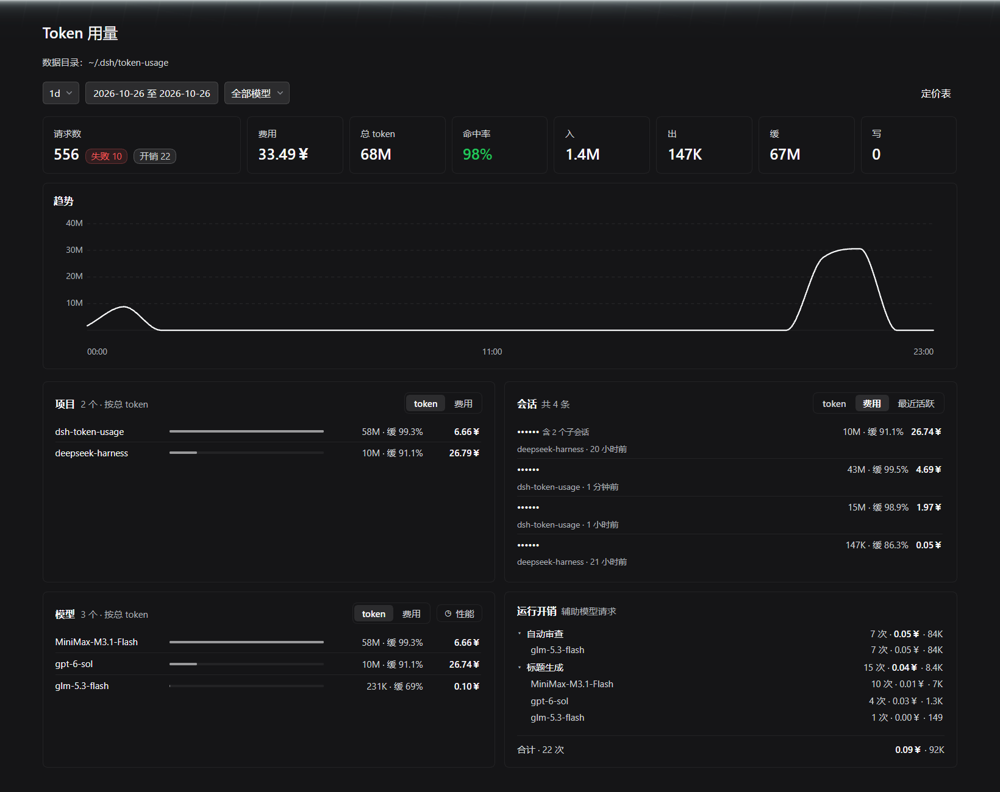
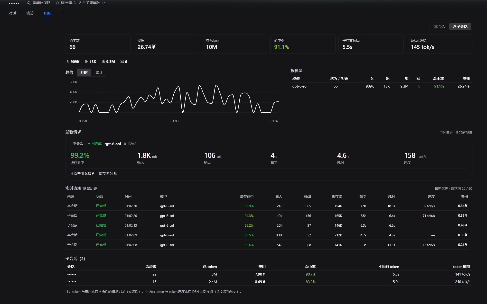
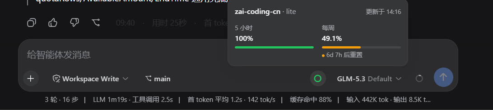
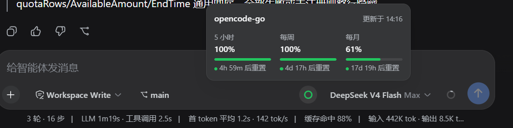

# dsh-token-usage

[](https://awesome-dsh-plugin.com)



简体中文 | [English](./README.md)

一个 [dsh] 用量插件：在 Web 界面直接展示模型 token 用量。安装后打开**设置**（侧栏底部齿轮），即可看到「Token 用量」页 —— 汇总卡片（含费用）、可互切的折线图与 Token 活动砖块日历、按模型 / 按会话明细表与定价弹窗，支持按日期区间和模型筛选，效果见上图。

[dsh]: https://github.com/cordiverse/dsh

仓库：<https://github.com/LaoYueHanNi/dsh-token-usage>

> [!IMPORTANT]
> **GitHub 直装已终止**——仓库不再携带构建产物，请改从 npm 安装：
>
> ```sh
> dsh plugin --profile web add @laoyuehanni/dsh-token-usage
> ```
>
> **从旧 `github:` 安装（≤ 0.3.7，包名 `dsh-token-usage`）升级？** 原地 `update` 会导致加载失败——先移除旧包名再重新安装。`$DSH_HOME/token-usage/` 下的历史数据完整保留。

## 功能

- **实时记录**：每一次 provider 计费调用发生即记录——token、费用、模型、会话；主对话请求、上下文压缩调用与系统辅助调用（自动审查、会话标题生成、推理翻译）都计入。辅助调用计入总量和按模型表，同时在明细切换的**运行开销**页签按类别单独拆出；它们不归属任何会话，因此按会话表只统计对话请求。这部分历史无法回补——宿主不保存这些调用的用量记录，升级后的第一个请求才开始记录。
- **Web 统计页**：过滤条（日期区间 + 模型下拉 + `1d`/`7d`/`30d` 快捷区间）、汇总卡片、按日趋势图（悬停查看当日总量）、按模型明细表。趋势图可切为 Codex 风格 **Token 活动砖块日历**，支持**每天 / 每周 / 累计总量**、逐块渐进动画和键盘查看数值；所有视角共用当前筛选，切换不会额外请求。明细表可在**按模型 / 按会话 / 运行开销**间切换：按会话表按工作区目录分组（可切为列表视图），总 token / 费用 / 最近活跃列可点击排序，**Ctrl+点击**会话行直达该会话的用量页；运行开销页签按类别列出自动审查、标题生成、推理翻译等辅助调用的次数、费用与 token。
- **会话用量页签**：对话面板新增「用量」视图页签（与聊天 / 轨迹并列），展示当前会话的 dashboard —— 六张数值卡（成功请求数带失败胶囊、费用、缓存命中率、首 token 平均延迟、出字速度、总 token）+ 四项 token 明细条 + 按小时趋势图 + 按模型表。「本会话 / 含子会话」一键切换范围，子会话表逐行钻取并可逐级返回。悬停失败胶囊可看按失败类别的明细（限流 / 网络异常 / 上下文超限 等逐一计数）。



- **费用统计与模型定价**：按模型单价（¥/百万 token）逐条实时计费，未定价模型高亮提示（费用按 ¥0 计）。定价模型的名字旁有**「定价」小按钮**，点击弹窗展示该模型的完整价格表；过滤条行尾另有**「定价表」**入口，弹窗内可浏览云端定价的全部模型——搜索、模拟计费、展开当前生效价。价格每次启动自动从云端同步——详见「[模型定价](#模型定价)」。
- **供应商配额**：输入栏模型选择器左侧的配额按钮，跟随当前选中的供应商展示套餐余量。详见「[供应商配额](#供应商配额)」。
- **历史补齐**：首次启动自动同步安装前已发生的请求（幂等）；无法解析的会话日志跳过并计数，绝不中断同步。

## 模型定价

每条记录按自身时间戳精确计费；名称或价格规则变化后，下次读取从原始记录重新选择历史费率。模型按「原名 ID → provider 去前缀 ID → 上游 aliasPatterns 正则（不再读取旧 aliases）」识别，全部忽略大小写，不混淆版本和模型变体；歧义或未命中不猜价格。定价仅来自启动自动同步的云端镜像——价格修订请去上游 [model-price-table](https://github.com/LaoYueHanNi/model-price-table) 仓库提 PR，全用户受益。手工编辑的 `pricing.json` 升级后不再被读取（文件保留在磁盘上，不会主动删除）。从 0.4.1 或更早版本升级到 0.4.2 后，首次打开统计页会触发一次历史汇总的全量重建——历史越大耗时越久，属一次性预期行为。新镜像校验失败保留旧有效镜像；无有效镜像或历史记录不足以完整重算时，保留可用用量、隐藏不可靠费用并显示原因。正常表的未定价模型单独告警。未定价名称可就地搜索已有模型、预览完整规则并明确保存关联；折叠行保留原始来源，管理入口可查看并撤销停用或未使用的关联。关联仅引用云端 ID，完整规则照常生效并重算历史。上游 Issue 入口只打开待补充的草稿，不自动提交。默认目录：`~/.dsh/token-usage/`。计费规则链、云端 feed 格式与自建镜像地址：[docs/pricing.md](./docs/pricing.md)。

## 配置

### 数据目录

在 Web 卡片（**设置 → 插件 → Token 用量**）里修改：保存绝对路径**立即生效**——历史数据自动迁移，无需重启、无需手动搬数据。留空保持默认 `~/.dsh/token-usage/`。对话进行中时保存会被拒绝，等对话结束再保存即可。也可用配置直接指定：

```yml
plugins:
  token-usage:
    path: D:/data/token-usage   # 缺省：~/.dsh/token-usage/
```

### 定价区域

定价镜像跟随区域：默认 **Gitee**（中国大陆内速度快），可切到同一张表的 **GitHub 镜像**——在 Web 卡片的「定价区域」下拉选一次，或用配置。该选择同时决定费用展示货币（¥ 人民币 / $ 美元，按定价表汇率换算）。

```yml
plugins:
  token-usage:
    pricingRegion: overseas   # 默认：domestic
```

## 供应商配额

输入栏按钮跟随当前选中的供应商，点开即可查看套餐余量（API Key 供应商与推理共用同一把密钥；DeepSeek 账号读取登录态余额）：





| 供应商 | 展示 |
|---|---|
| 智谱 GLM Coding Plan（国内 / 国际） | 5 小时、每周（部分套餐另有每月） |
| Kimi For Coding | 5 小时、每月（旧接口响应另含每周） |
| MiniMax Coding Plan（国内 / 国际） | 5 小时、每周 |
| OpenCode Go | 5 小时、每周、每月 |
| Command Code | 5 小时、每周、每月 |
| DeepSeek（官方 API Key） | ¥ 账户余额 |
| DeepSeek 账号 | 充值余额、赠金余额 |
| OpenRouter | $ 剩余额度 |

不支持的供应商不显示该按钮；查询失败可在面板内重试。默认开启，可用 `quota.enabled: false` 关闭。暂不支持：火山方舟、ZenMux、智谱团队版、Claude / Codex / Gemini / Grok 官方订阅、GitHub Copilot。

## 安装

```sh
dsh plugin --profile web add @laoyuehanni/dsh-token-usage
```

> 包声明了 `dsh.bundle`，`add` 自动把插件挂进 profile，开箱即用；首次启动自动补齐安装前的历史记录。

## 更新

```sh
dsh plugin --profile web update @laoyuehanni/dsh-token-usage
```

## 移除

```sh
dsh plugin --profile web remove @laoyuehanni/dsh-token-usage
```

数据文件（`$DSH_HOME/token-usage/`）会保留，需要时手动删除。

## 开发

构建一次、装符号链接、迭代：

```sh
pnpm install
pnpm build:all
pnpm test                # vitest
dsh plugin --profile web add link:D:/plugins/dsh-token-usage
```

重新构建并重启 `dsh web` 即生效（插件目录跑 `pnpm watch:client` 可热重载客户端）。刻意不设 `prepare` 脚本——`lib/` 从不进仓库，`pnpm publish` 现场构建打进 tarball。

临时挂载（仅当次启动生效，不动 profile）：复制 `cordis.example.yml` 为 `cordis.yml`，把 `name` 改成你机器上 `lib/index.js` 的绝对 `file://` URL，然后 `dsh web --patch <插件目录>/cordis.yml`。此模式数据记录照常，开发 UI 请用上面的 `link:` 安装。
