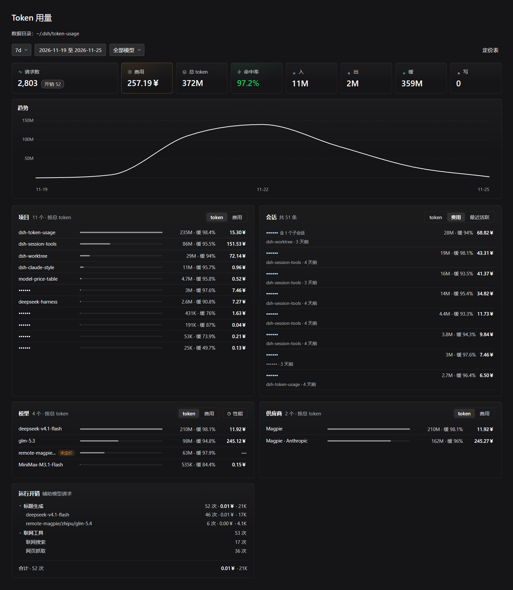
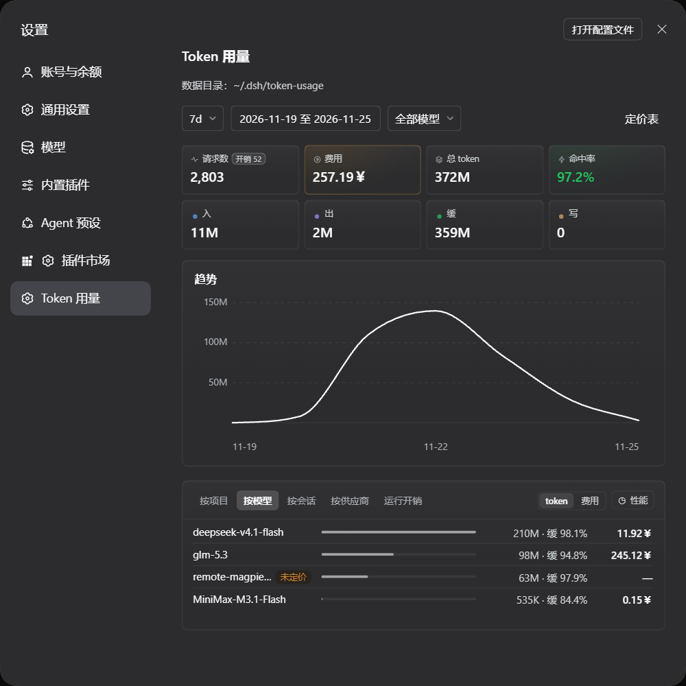
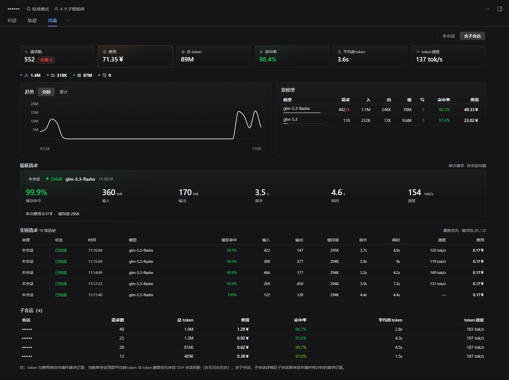
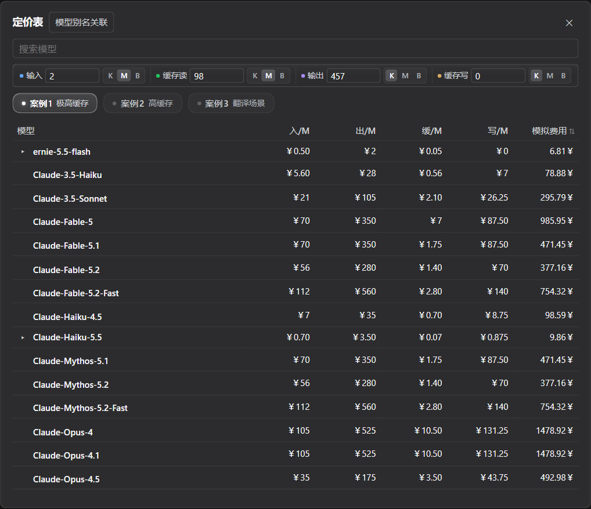
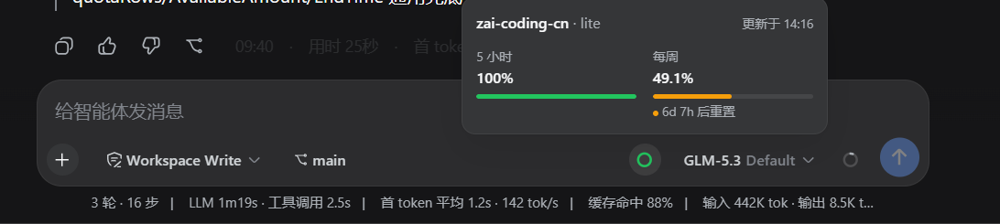
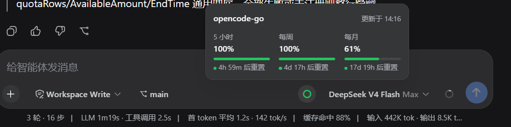

<div align="center">


# dsh-token-usage

**面向 [DeepSeek Harness (dsh)][dsh] 的一站式 Token 用量统计、费用核算、模型测速与供应商配额监控插件。**

<p>
  <a href="https://awesome-dsh-plugin.com"></a>
  <a href="https://www.npmjs.com/package/@laoyuehanni/dsh-token-usage"></a>
  <a href="https://www.npmjs.com/package/@laoyuehanni/dsh-token-usage"></a>
  <a href="https://github.com/deepseek-ai/deepseek-harness">= 0.2.1-rc.3" height="20" /></a>
  <a href="./LICENSE"></a>
</p>

**简体中文** · [English](./README.md)

[快速安装](#安装) · [核心功能](#核心功能) · [供应商配额](#供应商配额) · [模型定价](#4-费用统计与模型定价) · [配置](#配置) · [本地开发](#开发)

</div>

<p align="center">
  
</p>

---

## 核心亮点

| 能力 | 一句话说明 |
| --- | --- |
| **全宽大屏 & 设置统计页** | 侧栏大屏与 **设置 → Token 用量** 同步展示项目、会话、模型、供应商、运行开销五大维度与趋势图。 |
| **会话用量 & 实时请求池** | 对话面板新增 **用量** 页签，支持主/子会话钻取、运行中请求实时监控、失败分类与低缓存命中诊断。 |
| **模型性能测速** | 基于流式样本统计各模型的平均输出速度（tok/s）、首 token 延迟（TTFT）与请求耗时。 |
| **云端定价 & 实时计费** | 启动自动同步 [model-price-table](https://github.com/LaoYueHanNi/model-price-table) 价格表，支持 ¥ / $ 切换、模拟计费与本地别名映射。 |
| **多厂商配额监控** | 输入栏一键查看智谱 GLM、Kimi、MiniMax、OpenCode Go、Command Code、DeepSeek、OpenRouter 及 Magpie 网关余量。 |

---

## 安装

需要 **dsh `0.2.1-rc.3`** 及以上版本。

```sh
dsh plugin --profile web add @laoyuehanni/dsh-token-usage
```

> [!TIP]
> 包已声明 `dsh.bundle`，执行 `add` 会自动挂入 profile，开箱即用；首次启动会幂等补齐安装前的历史记录（无法解析的会话日志会跳过并计数，不中断同步）。

**更新与移除**

```sh
# 更新插件
dsh plugin --profile web update @laoyuehanni/dsh-token-usage

# 移除插件（$DSH_HOME/token-usage/ 下的历史数据会保留，需要时手动删除）
dsh plugin --profile web remove @laoyuehanni/dsh-token-usage
```

<details>
<summary>从旧版 <code>github:</code> 直装（≤ 0.3.7，包名 <code>dsh-token-usage</code>）升级？</summary>

GitHub 直装已终止（仓库不再携带构建产物）。原地 `update` 会导致加载失败，请先移除旧包名再从 npm 重新安装：

```sh
dsh plugin --profile web remove dsh-token-usage
dsh plugin --profile web add @laoyuehanni/dsh-token-usage
```

`$DSH_HOME/token-usage/` 下的历史数据会完整保留。

</details>

---

## 核心功能

### 1. 主列全宽大屏 & 设置统计页

- **双入口同步**：侧栏「Token 用量」打开五块看板全宽大屏（窄屏自动切单列）；**设置 → Token 用量**以五页签呈现同一套指标（**按项目 / 按模型 / 按会话 / 按供应商 / 运行开销**）。
- **多维筛选与直达**：共用日期区间、模型筛选及 `1d`/`7d`/`30d` 快捷按钮，配备八张紧凑汇总卡片（请求卡带「失败」与「开销」徽章）和趋势图（单日按小时、更宽区间按日）。支持按总 token / 费用 / 最近活跃排序，**Ctrl+点击**会话行可直接跳转对应对话。
- **侧栏与入口开关**：在宿主**插件页**的配置卡中开启**「常驻侧边栏」**，可将入口从「更多」菜单移至左侧栏固定行（两处互斥）；也可按需关闭**「在设置中显示 Token 用量」**。

<p align="center">
  
</p>

<details>
<summary>展开详情：按供应商维度、项目聚合与运行开销口径</summary>

- **按供应商统计维度**：逐个路由键列出展示名、相对进度条、总 token、缓存命中率与已计费用；设置页与大屏各自记住「总 token / 费用」排序选择。无路由键用量（日志已删、旧版历史、全局运行开销等）单列为沉底弱化的「缺失供应商」余量行，悬停可看原因——属于已知差额而非丢数。
- **项目聚合规则**：项目行在会话列表截断前聚合全部匹配的顶层会话；目录尾段相同的工作区会合并统计。
- **实时记录与运行开销**：实时记录每一次 provider 计费调用，涵盖主对话、上下文压缩及系统辅助调用（自动审查、会话标题生成、时间线报告、推理翻译）。**联网工具**单独记录每次 `web_search` 与 `web_fetch` 的调用次数、查询条数、耗时与失败状态（宿主报告 token 时计入总量与费用，否则仅展示次数）。可归属会话的辅助调用同时计入该会话总量、趋势与请求池；其余保持全局口径归入**运行开销**看板（辅助调用历史无法回补，升级后即开始记录）。

</details>

---

### 2. 会话用量页签 & 实时请求池

对话面板新增与「聊天 / 轨迹」并列的**「用量」**视图页签：

- **会话看板**：六张核心指标卡（成功请求数带按失败类别展开的胶囊、费用、缓存命中率、首字平均延迟、出字速度、总 token）+ 四项 token 明细条 + 分时/累计趋势图 + 按模型表。
- **子会话与团队协作钻取**：一键切换「本会话 / 含子会话」，支持逐级钻取并返回。适配 DSH 0.2.2+ 子代理**语义名**（如 `researcher`、`agent-1`），根会话启用协作时标注**「团队模式」**，并将无本地会话的**外部子代理**弱化标注为不计入本地账本。
- **实时请求池**：「最新请求」面板 +「实时请求」表（最多 19 条历史），运行中即可见等待、生成中、失败与已取消请求，每次 provider 尝试独立成行，并对低缓存命中给出行内诊断。

<p align="center">
  
</p>

---

### 3. 模型性能视图

模型列表支持一键切换至**平均输出速度**、**首 token 延迟**与**请求耗时**视图：

- 无计时请求不参与性能评价；
- 速度与首 token 均值仅取流式样本，少于 5 个流式样本的模型标记为样本不足、不参与排名；
- 汇总格式变化时自动从历史记录回填计时数据，无需手动清缓存。

---

### 4. 费用统计与模型定价

每条记录按自身时间戳精确计费（¥ 或 $ / 百万 token），未定价模型高亮告警并暂按 0 计。

- 点击看板中有定价的模型名可查看完整价格表，**Ctrl+点击**可快速过滤至该模型；
- 过滤条行尾提供**「定价表」**弹窗，支持搜索全部云端模型、模拟计费、展开生效规则，并通过**「模型别名关联」**管理或撤销本地别名映射。

<p align="center">
  
</p>

<details>
<summary>展开详情：模型匹配规则、云端同步与升级说明</summary>

- **匹配顺序**：原名 ID → 去除 provider 前缀 ID → 上游 `aliasPatterns` 正则（忽略大小写，严格区分版本与变体，不再读取旧 `aliases`；未命中或歧义不猜价）。
- **云端自动同步**：每次启动自动同步上游 [model-price-table](https://github.com/LaoYueHanNi/model-price-table) 镜像，价格修订欢迎去上游提 PR 让全用户受益。手工编辑的 `pricing.json` 升级后不再读取（文件保留在磁盘）。新镜像校验失败保留旧有效镜像；无法可靠重算时保留可用用量并隐藏不可靠费用。
- **未定价模型处理**：支持就地搜索已有模型、预览完整规则、显式保存本地关联并重算历史，以及一键打开预填好的上游 Issue 草稿（不会自动提交）。
- **从 ≤ 0.4.1 升级到 ≥ 0.4.2**：首次打开统计页会触发一次历史汇总全量重建，属一次性预期行为。
- 完整计费规则链、云端 feed 格式与自建镜像配置见 [docs/pricing.md](./docs/pricing.md)。

</details>

---

## 供应商配额

输入栏模型选择器左侧的配额按钮会跟随当前选中的供应商，点开即可查看套餐余量（API Key 供应商复用推理密钥；DeepSeek 账号读取登录态余额）：

<table>
  <tr>
    <td align="center" width="50%">
      
      <br />
      <sub>智谱 GLM Coding Plan</sub>
    </td>
    <td align="center" width="50%">
      
      <br />
      <sub>OpenCode Go 套餐</sub>
    </td>
  </tr>
</table>

| 供应商 | 展示指标 |
| --- | --- |
| **智谱 GLM Coding Plan**（国内 / 国际） | 5 小时、每周（部分套餐另有每月） |
| **Kimi For Coding** | 5 小时、每月（旧接口响应另含每周） |
| **MiniMax Coding Plan**（国内 / 国际） | 5 小时、每周 |
| **OpenCode Go** | 5 小时、每周、每月 |
| **Command Code** | 5 小时、每周、每月 |
| **DeepSeek**（官方 API Key） | ¥ 账户余额 |
| **DeepSeek 账号** | 充值余额、赠金余额 |
| **OpenRouter** | $ 剩余额度 |
| **Magpie 网关** | 全部上游账号配额卡，按所选模型自动限定到对应供应商 |

> 不支持的供应商自动隐藏按钮；查询失败可在面板内重试。默认开启，可用 `quota.enabled: false` 关闭。暂不支持：火山方舟、ZenMux、智谱团队版、Claude / Codex / Gemini / Grok 官方订阅、GitHub Copilot。

<details>
<summary>Magpie 网关接入与缓存说明</summary>

- **零配置接入**：声明任意 baseURL 指向网关（默认 `http://127.0.0.1:3425/v1`）的 OpenAI 兼容供应商即可，插件会通过 `hello` 接口自动识别。跨机器共享网关时把网关密钥填进供应商 API Key；本机网关无需密钥。
- **只读网关缓存（`?kept=1`）**：切换模型即刻跟随，轮询、打开面板与重试都只读取 Magpie 自身缓存，不触发上游供应商刷新（需要最新读数请在 Magpie 内刷新）。
- **多账号备份池**：输入栏圆环显示该供应商额度池的**均值水位**并按可用性上色（单账号用尽转黄，全池用尽才转红），面板仍逐账号列出各自余量；路由组场景下各供应商独立展示。

</details>

---

## 配置

以下配置均可在宿主**插件页**的配置卡中直接修改（立即生效），也可写入 `cordis.yml`：

```yml
plugins:
  token-usage:
    path: D:/data/token-usage   # 默认：~/.dsh/token-usage/（修改后自动迁移历史数据）
    pricingRegion: overseas     # domestic（Gitee 镜像，¥ 人民币）| overseas（GitHub 镜像，$ 美元）
    quota:
      enabled: true             # 设为 false 关闭输入栏配额按钮
```

> 在插件页修改 `path` 会自动迁移已有数据、无需重启；对话进行中时保存会被拒绝，等待对话结束再保存即可。

---

## 开发

```sh
pnpm install
pnpm build:all
pnpm test                # vitest
dsh plugin --profile web add link:D:/plugins/dsh-token-usage
```

重新构建并重启 `dsh web` 即生效，客户端开发可在插件目录运行 `pnpm watch:client` 热重载。刻意不设 `prepare` 脚本——`lib/` 不进仓库，`pnpm publish` 时现场构建打入 tarball。

<details>
<summary>临时挂载（仅当次启动生效，不改 profile）</summary>

复制 `cordis.example.yml` 为 `cordis.yml`，将 `name` 改为本机 `lib/index.js` 的绝对 `file://` URL，然后启动：

```sh
dsh web --patch <插件目录>/cordis.yml
```

此模式数据记录照常；开发 UI 请使用上面的 `link:` 安装方式。

</details>

---

[dsh]: https://github.com/deepseek-ai/deepseek-harness
